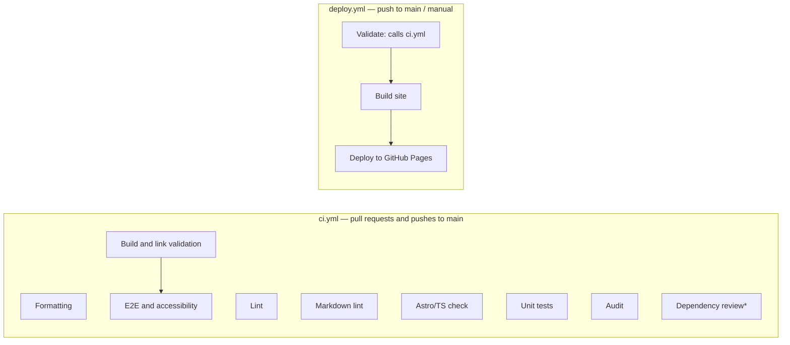

# Engineering Wiki

[](https://github.com/CharlieWoo01/engineering-wiki/actions/workflows/ci.yml)
[](https://github.com/CharlieWoo01/engineering-wiki/actions/workflows/deploy.yml)

A documentation-as-code engineering wiki built with [Astro Starlight](https://starlight.astro.build/)
and published to GitHub Pages: technical notes, engineering standards, research, Architecture
Decision Records and runbooks, written in Markdown, reviewed in pull requests and validated
automatically.

**Live site:** <https://charliewoo01.github.io/engineering-wiki/>

> [!WARNING]
> The site is **public**. GitHub Pages sites are accessible to anyone on the internet, even when
> the repository is private (unless you use GitHub Enterprise Cloud access control). Never commit
> secrets, credentials, internal hostnames, IP addresses, personal data or other sensitive
> information. See [Security and visibility](#security-and-visibility).

## Contents

- [Technology stack](#technology-stack)
- [Getting started](#getting-started)
- [Available commands](#available-commands)
- [Documentation structure](#documentation-structure)
- [Testing strategy](#testing-strategy)
- [CI/CD architecture](#cicd-architecture)
- [GitHub Pages deployment](#github-pages-deployment)
- [Security and visibility](#security-and-visibility)
- [Troubleshooting](#troubleshooting)
- [Future roadmap](#future-roadmap)

## Technology stack

| Concern            | Choice                                                                                                         |
| ------------------ | -------------------------------------------------------------------------------------------------------------- |
| Framework          | [Astro](https://astro.build/) 7 + [Starlight](https://starlight.astro.build/) 0.43                             |
| Language           | TypeScript 6 (`astro/tsconfigs/strictest`)                                                                     |
| Runtime            | Node.js 26 LTS (`.nvmrc`; Node.js 24 LTS also supported)                                                       |
| Package manager    | pnpm 12 (pinned via `packageManager`)                                                                          |
| Search             | Pagefind (built into Starlight, static, no backend)                                                            |
| Diagrams           | Mermaid via a local Starlight plugin (`src/plugins/mermaid`): brand-themed, captioned, expandable, lazy-loaded |
| Code blocks        | Expressive Code (built into Starlight) + official line-numbers plugin (`ec.config.mjs`)                        |
| Typography         | Inter and JetBrains Mono, self-hosted via Fontsource (no third-party requests)                                 |
| AI-readable output | [`starlight-llms-txt`](https://github.com/delucis/starlight-llms-txt): `/llms.txt`, `/llms-full.txt`           |
| Link validation    | [`starlight-links-validator`](https://github.com/HiDeoo/starlight-links-validator) + `scripts/check-links.ts`  |
| Linting/formatting | ESLint (`typescript-eslint` strict), Prettier, markdownlint                                                    |
| Testing            | Vitest, Playwright, axe-core                                                                                   |
| CI/CD and hosting  | GitHub Actions, GitHub Pages                                                                                   |

Why Starlight? See [ADR-0002](src/content/docs/adr/0002-use-astro-starlight-for-the-engineering-wiki.md).

## Getting started

### Prerequisites

- **Node.js 26** (or 24). With a version manager: `nvm use` / `fnm use` reads `.nvmrc`.
- **pnpm 12**: `npm install --global pnpm@12`. (Corepack is no longer bundled with Node.js 25+.)

### Local development

```sh
git clone https://github.com/CharlieWoo01/engineering-wiki.git
cd engineering-wiki
pnpm install
pnpm dev
```

Open <http://localhost:4321/engineering-wiki/>. Pages reload as you save.

To run the end-to-end tests locally, install the Playwright browser once:

```sh
pnpm exec playwright install chromium
```

## Available commands

| Command              | What it does                                                                                         |
| -------------------- | ---------------------------------------------------------------------------------------------------- |
| `pnpm dev`           | Start the dev server with hot reload.                                                                |
| `pnpm build`         | Build the production site into `dist/` (validates frontmatter and Markdown links).                   |
| `pnpm preview`       | Serve the production build locally.                                                                  |
| `pnpm check`         | Astro and TypeScript diagnostics, including content-schema (frontmatter) validation.                 |
| `pnpm lint`          | ESLint with type-aware `typescript-eslint` rules.                                                    |
| `pnpm format`        | Format all files with Prettier.                                                                      |
| `pnpm format:check`  | Fail if any file is not formatted.                                                                   |
| `pnpm lint:markdown` | markdownlint over all Markdown/MDX content, templates and repository docs.                           |
| `pnpm check:links`   | Production build, then verify every internal link and asset in `dist/` is under the base path.       |
| `pnpm test`          | Vitest unit tests.                                                                                   |
| `pnpm test:e2e`      | Playwright end-to-end and axe-core accessibility tests against the production build.                 |
| `pnpm validate`      | Everything above that CI runs, in order: format, lint, Markdown lint, check, unit tests, links, e2e. |

`pnpm validate` is the local equivalent of the CI workflow. The only CI checks it does not run
are the dependency audit and dependency review (run `pnpm audit --audit-level high` manually).

## Documentation structure

```text
src/content/docs/          # Every .md/.mdx file here becomes a page
├── index.mdx              # Landing page
├── 404.mdx                # Custom not-found page
├── getting-started/       # Introduction, about, contributing (authoring guide)
├── engineering/           # Principles, coding standards, patterns, testing, workflows
├── platform/              # Overview, architecture, infrastructure, DevEx, onboarding
├── devops/                # CI/CD, containers, IaC, deployment strategies
├── observability/         # OpenTelemetry, logging, metrics, tracing, alerting
├── security/              # Principles, dependency management, secrets management
├── knowledge-base/        # Technical notes, troubleshooting, commands, tips
├── research/              # Proofs of concept, technology evaluations, experiments
├── adr/                   # Architecture Decision Records
└── runbooks/              # Operational runbooks
templates/                 # Page templates (single source, rendered on template pages)
src/config/sections.ts     # Top-level sections: drives the sidebar and the homepage cards
src/components/            # Starlight overrides and homepage components (PageTitle, SectionGrid)
src/plugins/mermaid/       # Local Starlight plugin for Mermaid diagrams
src/styles/custom.css      # Theme layer: fonts, palette, tables, sidebar, hero
src/lib/                   # Small, unit-tested logic (deployment config, frontmatter, page metadata, a11y plugin)
scripts/check-links.ts     # Built-output link and asset checker
tests/unit/ · tests/e2e/   # Vitest and Playwright tests
```

- **Sidebar:** each top-level folder is a sidebar group generated automatically from
  `src/config/sections.ts`; pages are ordered with `sidebar.order` in frontmatter. A new page in
  an existing section needs **no configuration**, and homepage page counts update themselves.
- **Page metadata:** `status` (draft/deprecated), `owner` and `lastReviewed` are shown under each
  page title; pages not reviewed for 12 months are flagged **Review due**.
- **Diagrams:** ` ```mermaid title="…" ` blocks render with the wiki's colours, follow light/dark mode
  and open in a full-screen view with zoom.
- **Frontmatter:** `title` and `description` are required; `status`, `owner` and `lastReviewed`
  are optional. The schema is in `src/lib/frontmatter.ts` and enforced at build time.
- **Templates:** technical note, technical guide, ADR, runbook, proof of concept and technology
  evaluation, in `templates/`.
- **Links:** use relative links (`../../adr/introduction/`) so content works under any base path.

The full authoring guide — naming conventions, folder structure, frontmatter, callouts, code,
diagrams and the process for adding pages — is the
[Contributing page](src/content/docs/getting-started/contributing.mdx) in the wiki itself.
Many section pages are deliberately marked `status: draft`: they contain general guidance only
and no organisation-specific standards; illustrative content is labelled.

## Testing strategy

Proportionate to a static documentation site: most risk is in content and configuration, not
custom code.

| Layer                     | Tooling                                       | What it covers                                                                                                                                                                                                                           |
| ------------------------- | --------------------------------------------- | ---------------------------------------------------------------------------------------------------------------------------------------------------------------------------------------------------------------------------------------- |
| Static analysis           | TypeScript strictest, ESLint, Prettier        | Config, scripts and tests are type-safe and consistently formatted.                                                                                                                                                                      |
| Content validation        | Astro content schema, markdownlint            | Required frontmatter, valid values, Markdown style.                                                                                                                                                                                      |
| Link and asset validation | `starlight-links-validator`, `check-links.ts` | Broken page links and heading anchors in source; broken links, missing CSS/JS/images and base-path escapes in the build output.                                                                                                          |
| Unit tests                | Vitest (`tests/unit/`)                        | The custom logic: deployment config, frontmatter schema, page metadata, link checker, Mermaid transform and theming, task-list a11y plugin.                                                                                              |
| End-to-end                | Playwright (`tests/e2e/`), desktop + mobile   | Homepage and section counts, page rendering and metadata, code copy and line numbers, Mermaid rendering, theme re-render and expanded view, templates, sidebar, every sidebar link, search, theme switching, mobile menu, 404, llms.txt. |
| Accessibility             | axe-core with Playwright                      | WCAG 2.2 A/AA on representative pages and the expanded diagram view, in light and dark themes.                                                                                                                                           |
| External links            | lychee (scheduled workflow)                   | Weekly; opens an issue instead of blocking pull requests.                                                                                                                                                                                |

E2E tests run against the **production build** served by `astro preview` under the real
`/engineering-wiki/` base path, so they also verify GitHub Pages compatibility. Tests use only
local content, so they are deterministic and run identically locally and in CI.

**Accessibility exceptions:** one known upstream Starlight issue (the search button's `Ctrl K`
hint is not part of its accessible name) is excluded for that rule and element only; see
`tests/e2e/accessibility.spec.ts`.

## CI/CD architecture



\* Pull requests only.

- **Parallel jobs:** every check except E2E runs in parallel; E2E reuses the build artifact.
- **Shared setup:** `.github/actions/setup` installs pnpm and Node.js (from `packageManager` and
  `.nvmrc`), restores the pnpm store cache and runs `pnpm install --frozen-lockfile`.
- **Cancellation:** superseded runs for the same pull request or branch are cancelled.
- **Least privilege:** workflows default to `contents: read`; only the deploy job receives
  `pages: write` and `id-token: write`. No secrets are used.
- **Forks:** pull requests use the `pull_request` event (never `pull_request_target`), so fork
  code runs with a read-only token and no secrets. Checkouts set `persist-credentials: false`.
- **Pinned actions:** every action is pinned to a full commit SHA; Dependabot updates them.
- **Supply chain:** pnpm's `minimumReleaseAge` (`pnpm-workspace.yaml`) refuses versions published
  less than 24 hours ago; CI runs `pnpm audit` and GitHub dependency review.
- **Deploy gating:** `deploy.yml` runs the full CI workflow as a reusable workflow before building,
  so manual deployments are validated too. A single `pages` concurrency group prevents concurrent
  deployments. The deployed URL is shown on the run's environment and in the job summary.

Pushing to `main` runs the CI workflow and the deploy workflow (which re-runs CI internally). The
duplication is intentional: it keeps the CI badge and branch history accurate while making every
deployment self-validating.

### Recommended branch protection

In **Settings → Rules → Rulesets** (or **Branches → Branch protection rules**) for `main`:

- Require a pull request before merging (at least one approval if there are multiple maintainers).
- Require status checks to pass, and require branches to be up to date. Required checks:
  - `Formatting (Prettier)`
  - `Lint (ESLint)`
  - `Markdown lint`
  - `Astro and TypeScript check`
  - `Unit tests (Vitest)`
  - `Dependency audit`
  - `Dependency review`
  - `Build and link validation`
  - `End-to-end and accessibility tests`
- Require conversation resolution before merging.
- Block force pushes and branch deletion.
- Optionally require signed commits and linear history.

## GitHub Pages deployment

### One-time repository setup

1. **Settings → Pages → Build and deployment → Source:** select **GitHub Actions**.
2. **Settings → Environments → `github-pages`** (created automatically on first deploy): keep the
   deployment branch rule limited to `main`.
3. **Settings → Actions → General → Workflow permissions:** "Read repository contents" is
   sufficient — workflows request any extra permissions explicitly.
4. **Settings → Code security:** enable the dependency graph (required by dependency review),
   Dependabot alerts and security updates, secret scanning with push protection, and private
   vulnerability reporting (referenced by `SECURITY.md`).
5. Push to `main` or run **Actions → Deploy → Run workflow**.

### Base path and custom domains

The site is served from `https://charliewoo01.github.io/engineering-wiki/`. Astro's `site` and
`base` come from `SITE_URL` and `BASE_PATH` (`src/lib/deployment.ts`), defaulting to that URL.
In CI the deploy workflow passes the values reported by `actions/configure-pages`, so:

- **To use a custom domain:** configure it under **Settings → Pages → Custom domain**. The next
  deployment builds with the new origin and base path `/` automatically — no code changes. Only
  the hard-coded links in `README.md`, `CONTRIBUTING.md` and the issue templates need updating.
- **To build for another host locally:**
  `SITE_URL=https://docs.example.com BASE_PATH=/ pnpm build`.

Content uses relative links, and `pnpm check:links` fails if any built link escapes the base path.

### Rolling back

See the runbook: [Roll back a GitHub Pages deployment](src/content/docs/runbooks/rollback-github-pages-deployment.md).

## Security and visibility

- GitHub Pages sites are **publicly accessible** and may be indexed by search engines, even from
  a private repository. Access-controlled Pages requires GitHub Enterprise Cloud.
- Private or sensitive engineering documentation **must not** be published here. If that need
  arises, move to private hosting with authentication first (see the roadmap).
- The site is static: no backend, database, cookies, analytics or user data.
- Report vulnerabilities privately as described in [SECURITY.md](SECURITY.md).

## Troubleshooting

| Problem                                                  | Fix                                                                                           |
| -------------------------------------------------------- | --------------------------------------------------------------------------------------------- |
| `pnpm` uses the wrong version or fails to switch to 12   | Install pnpm 12 globally: `npm install --global pnpm@12`.                                     |
| `ERR_PNPM_MINIMUM_RELEASE_AGE_VIOLATION`                 | A dependency version is less than 24 hours old. Wait, or pin the previous version.            |
| Styles or links broken on GitHub Pages only              | A root-relative link skips the base path. Use relative links; run `pnpm check:links`.         |
| Build fails with a frontmatter error                     | Add the missing `title`/`description` or fix the value; see the Contributing page.            |
| Build fails with "invalid link"                          | A page was renamed or a heading changed; update the link or anchor.                           |
| `Executable doesn't exist` in Playwright                 | `pnpm exec playwright install chromium`.                                                      |
| Port 4321 in use when running E2E tests                  | Stop the other server, or let Playwright reuse it (it does locally by default).               |
| "Last updated" dates missing                             | Dates come from Git history; avoid shallow clones (`git fetch --unshallow`).                  |
| `Invalid BASE_PATH … "C:/Program Files/Git/"` (Git Bash) | Git Bash rewrites `/` to a Windows path. Prefix with `MSYS_NO_PATHCONV=1`, or use PowerShell. |
| `astro check` reports missing `astro:content` types      | Run `pnpm astro sync` (also run automatically by `pnpm lint`).                                |

More entries: [Knowledge Base › Troubleshooting](src/content/docs/knowledge-base/troubleshooting.md).

## Future roadmap

Potential enhancements, deliberately **not** implemented yet:

- **Platform handbook and engineering standards:** replace draft pages with agreed content.
- **Team-specific documentation:** per-team folders as nested sidebar groups.
- **Documentation ownership:** `CODEOWNERS` and use of the `owner` frontmatter field.
- **Documentation quality reporting:** stale-page reports from `lastReviewed` and `status`.
- **Service catalogue:** generated from structured data, or integration with a developer portal.
- **Versioned documentation:** for example the
  [`starlight-versions`](https://github.com/HiDeoo/starlight-versions) plugin.
- **Alternative hosting:** the static `dist/` output works on any static host (Cloudflare Pages,
  Netlify, Azure Static Web Apps, S3 + CloudFront); set `SITE_URL`/`BASE_PATH` accordingly.
- **Private hosting and authentication:** required before any internal or sensitive content is
  added — for example an identity-aware proxy, a private static host with SSO, or GitHub
  Enterprise Cloud access-controlled Pages.

## Contributing

See [CONTRIBUTING.md](CONTRIBUTING.md).

## Licence

No licence has been chosen yet. Until one is added, all rights are reserved by the repository
owner.
