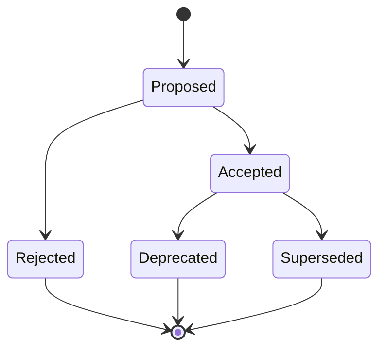

An **Architecture Decision Record (ADR)** captures a single significant decision: its context, the
options considered, the decision itself and its consequences. Together, ADRs form a log that
explains _why_ a system looks the way it does.

## When to write an ADR

Write one when a decision:

- is hard or expensive to reverse;
- affects several teams, services or the platform as a whole;
- chooses between credible alternatives; or
- will prompt someone to ask "why did we do it this way?" in a year's time.

## Lifecycle

ADRs are **immutable once accepted**. To change a decision, write a new ADR that supersedes the
old one, and update the old ADR's status to link to its replacement.

## Process

1. Copy the [ADR template](../template/) to `src/content/docs/adr/NNNN-short-title.md`, using the
   next number.
2. Open a pull request with status **Proposed**. The pull request is the discussion.
3. When agreed, set the status to **Accepted** and merge.

## Index

| ADR                                                           | Title                                        | Status   |
| ------------------------------------------------------------- | -------------------------------------------- | -------- |
| [0001](../0001-record-architecture-decisions/)                | Record architecture decisions                | Accepted |
| [0002](../0002-use-astro-starlight-for-the-engineering-wiki/) | Use Astro Starlight for the Engineering Wiki | Accepted |

## Further reading

- [Michael Nygard — Documenting Architecture Decisions](https://cognitect.com/blog/2011/11/15/documenting-architecture-decisions)
- [adr.github.io](https://adr.github.io/)
