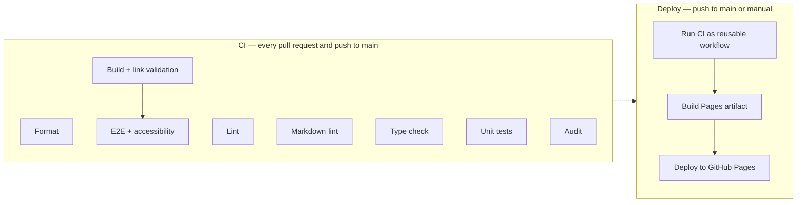

**Continuous integration (CI)** merges and validates every change automatically. **Continuous
delivery (CD)** keeps the default branch always releasable and automates the path to production.

## Good pipeline properties

- **Fast:** pull request checks should finish in minutes; run independent jobs in parallel.
- **Deterministic:** pinned dependencies and lockfiles, no reliance on flaky external services.
- **Secure:** least-privilege tokens, actions pinned to commit SHAs, no secrets exposed to forks.
- **Gated:** deployments only happen after every required check passes.
- **Observable:** failures say clearly what broke and how to reproduce it locally.

## Worked example: this wiki

This repository's pipelines are a real, working example.

| Practice                  | How the wiki implements it                                                   |
| ------------------------- | ---------------------------------------------------------------------------- |
| Frozen dependencies       | `pnpm install --frozen-lockfile`                                             |
| Caching                   | `actions/setup-node` pnpm store cache                                        |
| Cancel superseded runs    | `concurrency` with `cancel-in-progress`                                      |
| Least privilege           | `permissions: contents: read` by default; Pages write only in the deploy job |
| Pinned actions            | Full commit SHAs, updated by Dependabot                                      |
| No concurrent deployments | A single `pages` concurrency group                                           |

The workflow files live in `.github/workflows/` in the repository.

## Further reading

- [GitHub Actions — security hardening](https://docs.github.com/en/actions/security-for-github-actions/security-guides/security-hardening-for-github-actions)
- [Continuous Delivery (Jez Humble and David Farley)](https://continuousdelivery.com/)
