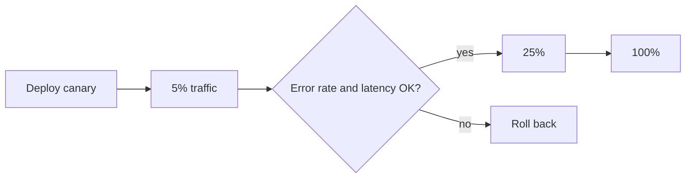

The right deployment strategy balances risk, speed and infrastructure cost.

## Comparison

| Strategy      | How it works                                                     | Rollback speed | Extra cost | Best for                                 |
| ------------- | ---------------------------------------------------------------- | -------------- | ---------- | ---------------------------------------- |
| Recreate      | Stop the old version, start the new one.                         | Slow           | None       | Non-critical or batch workloads.         |
| Rolling       | Replace instances gradually.                                     | Medium         | Low        | Stateless services (common default).     |
| Blue-green    | Run two environments; switch traffic all at once.                | Instant        | High       | Fast, low-risk cut-over and rollback.    |
| Canary        | Send a small share of traffic to the new version, then increase. | Fast           | Medium     | High-traffic services with good metrics. |
| Feature flags | Deploy code dark; enable features independently of deployment.   | Instant        | Tooling    | Decoupling release from deployment.      |

## Canary rollout

Canary analysis is only as good as your telemetry — see
[Monitoring and alerting](../../observability/monitoring-and-alerting/).

## Static sites

For a static site like this wiki, each deployment replaces the whole site atomically. Rollback
means redeploying a previous commit — see the
[rollback runbook](../../runbooks/rollback-github-pages-deployment/).
