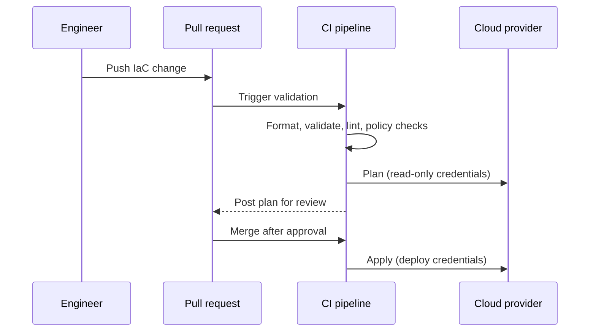

:::caution[Draft]
General guidance only. No IaC tool or repository structure has been standardised.
:::

Infrastructure as Code (IaC) defines infrastructure in versioned files, so it can be reviewed,
tested and reproduced like application code.

## Principles

- **Declarative:** describe the desired state; let the tool work out the changes.
- **Reviewed:** every change goes through a pull request showing the planned diff.
- **Idempotent:** applying the same code twice changes nothing the second time.
- **Modular:** share well-tested modules rather than copying blocks between environments.
- **Drift-aware:** detect and reconcile manual changes.

## Typical workflow

## Common tools

| Tool                                                                                       | Notes                                     |
| ------------------------------------------------------------------------------------------ | ----------------------------------------- |
| [OpenTofu](https://opentofu.org/) / [Terraform](https://developer.hashicorp.com/terraform) | Multi-cloud, HCL, large module ecosystem. |
| [Pulumi](https://www.pulumi.com/)                                                          | IaC in general-purpose languages.         |
| [AWS CDK](https://aws.amazon.com/cdk/)                                                     | AWS-specific, synthesises CloudFormation. |
| [Bicep](https://learn.microsoft.com/en-us/azure/azure-resource-manager/bicep/)             | Azure-native declarative language.        |
