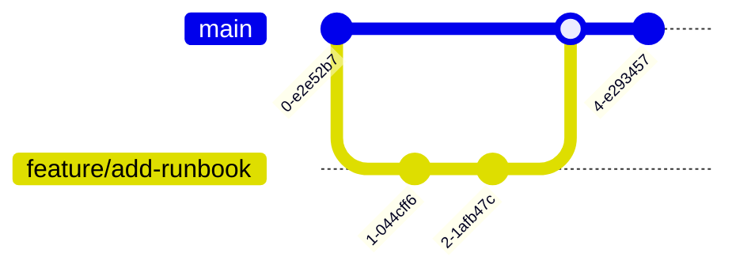

:::caution[Draft]
Describes common, well-documented practices. No team-specific workflow has been agreed yet.
:::

## Trunk-based development

Short-lived branches are merged into the default branch frequently (ideally within a day or two).
This keeps integration pain low and pairs naturally with continuous delivery.



## Pull requests

- Keep pull requests small and focused on one change.
- Describe **why** the change is needed, not only what changed.
- Make CI green before requesting review.
- Prefer squash merging to keep a readable history on the default branch.

## Commit messages

[Conventional Commits](https://www.conventionalcommits.org/) give history a consistent shape and
enable automated changelogs:

```text
feat(observability): add OpenTelemetry collector diagram
fix(runbooks): correct rollback command
docs: clarify frontmatter requirements
```

## Code review

- Review for correctness, clarity and risk first; leave style to automated tools.
- Distinguish blocking comments from suggestions (for example, prefix with `nit:`).
- Approve when the change is an improvement, even if it is not how you would have written it.

## Further reading

- [trunkbaseddevelopment.com](https://trunkbaseddevelopment.com/)
- [Google Engineering Practices — Code Review](https://google.github.io/eng-practices/review/)
