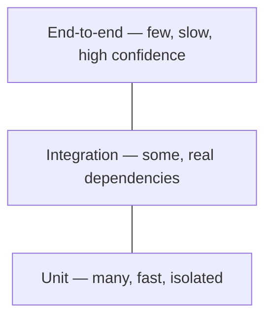

:::caution[Draft]
General guidance only. Team-specific expectations (coverage targets, required test types) have
not been agreed.
:::

## Choose tests by risk, not by ratio

The classic test pyramid — many unit tests, fewer integration tests, very few end-to-end tests —
is a useful default, but the right mix depends on where the risk lives. A static documentation
site, for example, has little custom logic and benefits most from build-time validation and a
handful of browser tests.

## Test types

| Type            | Verifies                                   | Typical tools                        |
| --------------- | ------------------------------------------ | ------------------------------------ |
| Static analysis | Types, lint rules, formatting              | TypeScript, ESLint, Prettier         |
| Unit            | A function or module in isolation          | Vitest, Jest, pytest, `go test`      |
| Integration     | Components working with real dependencies  | Testcontainers, test databases       |
| Contract        | Producer and consumer agree on an API      | Pact, schema validation              |
| End-to-end      | User journeys through the deployed system  | Playwright, Cypress                  |
| Accessibility   | Pages are usable with assistive technology | axe-core, manual screen reader tests |
| Performance     | Latency and throughput under load          | k6, Gatling                          |

## Qualities of a good test suite

- **Deterministic:** the same code always gives the same result. Quarantine and fix flaky tests.
- **Fast feedback:** the checks run on every pull request finish in minutes.
- **Meaningful:** tests assert behaviour users care about, not implementation details or coverage
  numbers.
- **Runnable locally:** anything CI runs, an engineer can run with one command.

## Example: this repository

The wiki uses Vitest for its small amount of custom logic, Playwright for user journeys, axe-core
for accessibility and build-time link validation. See the repository README for details.

## Further reading

- [Martin Fowler — The Practical Test Pyramid](https://martinfowler.com/articles/practical-test-pyramid.html)
- [Google Testing Blog](https://testing.googleblog.com/)
