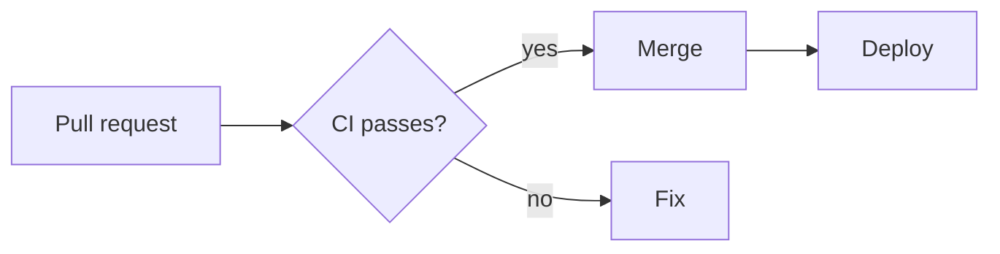

import { Code, FileTree, Steps, Tabs, TabItem } from '@astrojs/starlight/components';
import guideTemplate from '../../../../templates/technical-guide.md?raw';

Every page is a Markdown (`.md`) or MDX (`.mdx`) file under `src/content/docs/`. The sidebar is
generated from the folder structure, so most new pages need **no configuration changes**.

## Add a new page

<Steps>

1. Choose the section folder that fits best (see [Folder structure](#folder-structure)).

2. Copy the most suitable template from the repository's `templates/` folder:

   ```sh
   cp templates/technical-note.md src/content/docs/knowledge-base/my-new-note.md
   ```

3. Fill in the [frontmatter](#frontmatter) and replace the italic prompts with real content.

4. Preview locally with `pnpm dev`, then run `pnpm validate` before pushing.

5. Open a pull request. CI validates the change and, once merged, the site deploys
   automatically.

</Steps>

## Folder structure

Each top-level folder becomes a sidebar group. Nested folders become nested groups.

<FileTree>

- src/content/docs/
  - index.mdx homepage
  - 404.mdx custom not-found page
  - getting-started/
  - engineering/
  - platform/
  - devops/
  - observability/
  - security/
  - knowledge-base/
  - research/
  - adr/ Architecture Decision Records
    - 0001-record-architecture-decisions.md
  - runbooks/
- templates/ page templates (not published)
- src/assets/ images referenced from pages

</FileTree>

Adding a **new top-level section** is the only change that needs configuration: create the folder
and add one entry to `src/config/sections.ts`. That single list drives both the sidebar and the
section cards on the homepage, whose page counts update automatically.

## Naming conventions

| Item     | Convention                                            | Example                                 |
| -------- | ----------------------------------------------------- | --------------------------------------- |
| Files    | `kebab-case`, lowercase, descriptive; becomes the URL | `distributed-tracing.md`                |
| Folders  | `kebab-case`, plural nouns for collections            | `runbooks/`                             |
| ADRs     | Zero-padded, sequential number, then the decision     | `0003-adopt-opentelemetry.md`           |
| Runbooks | Verb phrase describing the operation                  | `rollback-github-pages-deployment.md`   |
| Images   | Next to the topic in `src/assets/`, `kebab-case`      | `src/assets/observability/pipeline.png` |
| Titles   | Sentence case                                         | `Monitoring and alerting`               |

Renaming a file changes its URL. Search the repository for links to the old path before renaming;
the link validator will fail the build if you miss one.

## Frontmatter

Frontmatter is validated at build time against Starlight's schema plus a few wiki-specific fields
(`src/lib/frontmatter.ts`). Invalid frontmatter fails `pnpm check` and `pnpm build`.

| Field           | Required | Description                                                             |
| --------------- | -------- | ----------------------------------------------------------------------- |
| `title`         | Yes      | Page title, rendered as the `<h1>` and in the browser tab.              |
| `description`   | Yes      | One sentence (10–200 characters) used for search results and meta tags. |
| `status`        | No       | `draft`, `published` (default) or `deprecated`.                         |
| `owner`         | No       | Person or team accountable for keeping the page accurate.               |
| `lastReviewed`  | No       | Date the content was last checked for accuracy, as `YYYY-MM-DD`.        |
| `tags`          | No       | Up to six lowercase kebab-case topics, e.g. `[security, ci-cd]`.        |
| `sidebar.order` | No       | Position within its sidebar group (lower numbers first).                |
| `sidebar.label` | No       | Shorter label for the sidebar if the title is long.                     |

All other [Starlight frontmatter](https://starlight.astro.build/reference/frontmatter/) fields are
also available.

`status` (when `draft` or `deprecated`), `owner`, `lastReviewed`, an estimated reading time and
the page's tags are shown under the page title. Pages not reviewed for 12 months are flagged **Review due**, so set `lastReviewed` whenever
you check a page for accuracy.

```yaml title="Example frontmatter"
---
title: Distributed tracing
description: How to instrument services so requests can be followed across boundaries.
status: draft
owner: Platform team
lastReviewed: 2026-11-25
tags: [observability, opentelemetry]
sidebar:
  order: 4
---
```

:::note
Do not add an `#` heading to the page body. Starlight renders `title` as the page heading, so
content starts at `##`.
:::

## Writing conventions

### Links

Use **relative links** with a trailing slash for links between pages. They work locally, on
GitHub Pages under `/engineering-wiki/` and on any future custom domain.

<Tabs>
  <TabItem label="Do">

```md
See [Logging](../../observability/logging/) and [the ADR template](../../adr/template/#template).
```

  </TabItem>
  <TabItem label="Don't">

```md
See [Logging](/observability/logging/) or [Logging](logging.md).
```

  </TabItem>
</Tabs>

Internal links and heading anchors are validated during every build.

### Callouts

Use Starlight's asides for notes, tips, warnings and dangers:

```md
:::tip[Optional custom title]
Asides support **Markdown**.
:::
```

:::tip
Variants are `note`, `tip`, `caution` and `danger`.
:::

### Code

Fenced code blocks are syntax highlighted and have a copy button. Add a `title` to show a file
name, mark lines to draw attention to them, and add `showLineNumbers` for long listings that
readers will refer to by line:

````md
```ts title="src/example.ts" {2} showLineNumbers
export function greet(name: string) {
  return `Hello, ${name}`;
}
```
````

### Diagrams

Use fenced `mermaid` code blocks. Diagrams use the wiki's colours, follow the light/dark theme
and can be opened in a full-screen view with zoom. Always add a `title`: it becomes the
diagram's caption and its accessible name for screen reader users.

````md

````

### Illustrative content

Do not invent organisation-specific standards, policies or decisions. When a page contains an
example rather than an agreed standard, say so with a `caution` aside titled
`Illustrative example`, and use `status: draft` until the content is agreed.

### MDX and components

Use plain Markdown unless you need a component. When you do, prefer
[Starlight's built-in components](https://starlight.astro.build/components/using-components/)
(`Tabs`, `Steps`, `Card`, `FileTree`, …) and rename the file to `.mdx`.

## Templates

Templates live in the repository's `templates/` folder and are the single source of truth — the
template pages in this wiki render those files directly.

| Template                             | Use it for                                           | Preview                                                          |
| ------------------------------------ | ---------------------------------------------------- | ---------------------------------------------------------------- |
| `templates/technical-note.md`        | A short, focused write-up of something you learned.  | [Technical notes](../../knowledge-base/technical-notes/)         |
| `templates/technical-guide.md`       | Step-by-step instructions to achieve an outcome.     | [Below](#technical-guide-template)                               |
| `templates/adr.md`                   | Recording a significant architectural decision.      | [ADR template](../../adr/template/)                              |
| `templates/runbook.md`               | An operational procedure for a known scenario.       | [Runbook template](../../runbooks/template/)                     |
| `templates/proof-of-concept.md`      | Planning and reporting a timeboxed proof of concept. | [Proofs of concept](../../research/proofs-of-concept/)           |
| `templates/technology-evaluation.md` | Comparing options against weighted requirements.     | [Technology evaluations](../../research/technology-evaluations/) |

### Technical guide template

<Code code={guideTemplate} lang="md" title="templates/technical-guide.md" />

## Review checklist

Reviewers should check that a page:

- [ ] Has an accurate `title` and a meaningful `description`.
- [ ] Contains no secrets, internal hostnames, personal or customer data.
- [ ] Labels illustrative content and uses `status: draft` where appropriate.
- [ ] Uses relative links and passes `pnpm validate`.
- [ ] Is in the right section with a sensible file name.

## Tags and documentation health

Tags connect pages across sections. Each tag gets its own page listing every page that uses it,
and [Browse by tag](../../tags/) lists them all. Reuse existing tags where possible rather than
inventing near-duplicates.

The [Documentation health](../../health/) page is generated on every deploy. It lists drafts,
pages due for review, and pages without an owner, review date or tags, which makes it a good
place to start when tidying the wiki.
