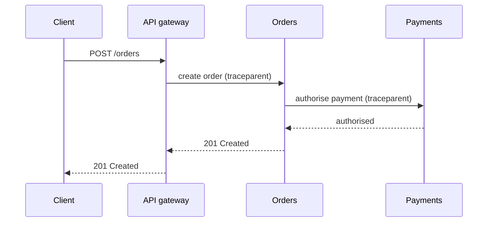

A **trace** records the path of a single request through a distributed system. It is made of
**spans** — timed operations with attributes — linked by parent–child relationships.

## Context propagation

Services pass trace context to each other, usually in the W3C
[`traceparent`](https://www.w3.org/TR/trace-context/) HTTP header:

```text
traceparent: 00-4bf92f3577b34da6a3ce929d0e0e4736-00f067aa0ba902b7-01
             │  │                                │                └─ flags (sampled)
             │  │                                └─ parent span ID
             │  └─ trace ID
             └─ version
```



All four spans share one trace ID, so the whole request appears as a single waterfall in your
tracing backend.

## Sampling

| Approach      | Decided  | Trade-off                                                        |
| ------------- | -------- | ---------------------------------------------------------------- |
| Head sampling | At start | Cheap and simple, but may drop the interesting (failed) traces.  |
| Tail sampling | At end   | Keeps errors and slow traces; needs a collector to buffer spans. |

## Further reading

- [OpenTelemetry traces](https://opentelemetry.io/docs/concepts/signals/traces/)
- [W3C Trace Context](https://www.w3.org/TR/trace-context/)
