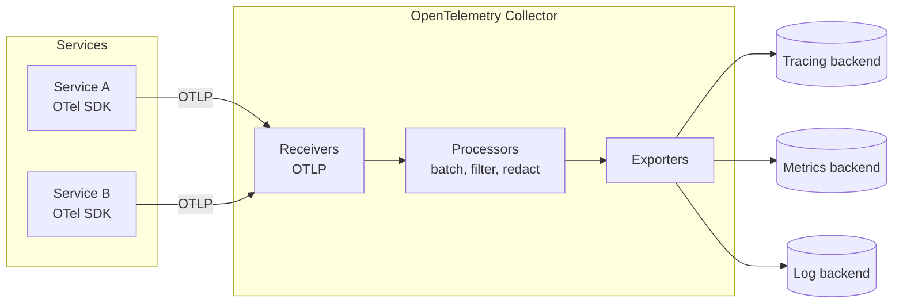

[OpenTelemetry](https://opentelemetry.io/) (OTel) is a vendor-neutral, CNCF-hosted standard for
generating, collecting and exporting telemetry: **traces**, **metrics** and **logs**. Instrument
once with OTel and send data to any compatible backend.

## Core concepts

| Concept              | Description                                                                   |
| -------------------- | ----------------------------------------------------------------------------- |
| Signal               | A type of telemetry: traces, metrics, logs (and profiles, in development).    |
| API / SDK            | The API is what code calls; the SDK implements it and configures export.      |
| Instrumentation      | Code that produces telemetry — automatic (zero-code) or manual.               |
| Resource             | Attributes describing the entity producing telemetry, such as `service.name`. |
| Semantic conventions | Standard attribute names (for example `http.request.method`) for consistency. |
| OTLP                 | The OpenTelemetry Protocol used to transport telemetry over gRPC or HTTP.     |
| Collector            | A standalone service that receives, processes and exports telemetry.          |

## Typical pipeline



Sending telemetry through a collector, rather than directly from each service to a vendor,
decouples applications from backends and gives one place to batch, sample and redact data.

## Example: collector configuration

```yaml title="otel-collector.yaml" showLineNumbers
receivers:
  otlp:
    protocols:
      grpc:
        endpoint: 0.0.0.0:4317
      http:
        endpoint: 0.0.0.0:4318

processors:
  memory_limiter:
    check_interval: 1s
    limit_percentage: 80
  batch: {}

exporters:
  debug:
    verbosity: basic

service:
  pipelines:
    traces:
      receivers: [otlp]
      processors: [memory_limiter, batch]
      exporters: [debug]
```

## Example: Node.js zero-code instrumentation

```sh
npm install @opentelemetry/api @opentelemetry/auto-instrumentations-node

export OTEL_SERVICE_NAME="checkout"
export OTEL_EXPORTER_OTLP_ENDPOINT="http://localhost:4318"
node --require @opentelemetry/auto-instrumentations-node/register app.js
```

:::tip
Always set `service.name` (via `OTEL_SERVICE_NAME`). Without it, telemetry from different
services is hard to tell apart.
:::

## Related pages

- [Logging](../logging/), [Metrics](../metrics/) and [Distributed tracing](../distributed-tracing/)
- [Monitoring and alerting](../monitoring-and-alerting/)

## Further reading

- [OpenTelemetry documentation](https://opentelemetry.io/docs/)
- [Semantic conventions](https://opentelemetry.io/docs/specs/semconv/)
- [Collector configuration](https://opentelemetry.io/docs/collector/configuration/)
