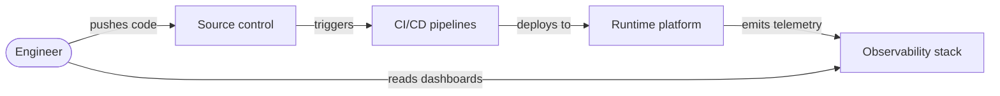

:::caution[Placeholder]
No platform architecture is documented yet. The diagram below is an **illustrative example** of
the notation, not a description of a real system.
:::

## Recommended approach

Use the [C4 model](https://c4model.com/) to describe architecture at increasing levels of
detail — context, containers, components — and keep diagrams in Markdown as Mermaid so they are
versioned and reviewed like code.

## Illustrative example: system context

## What to document

- **Context:** who uses the platform and which external systems it depends on.
- **Containers:** the deployable pieces and how they communicate.
- **Key decisions:** link each significant choice to an [ADR](../../adr/introduction/).
- **Quality attributes:** availability, scalability and security expectations.
